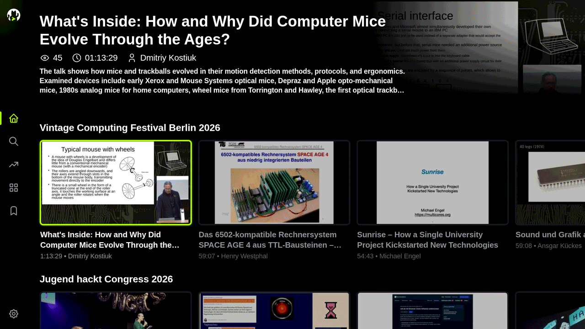
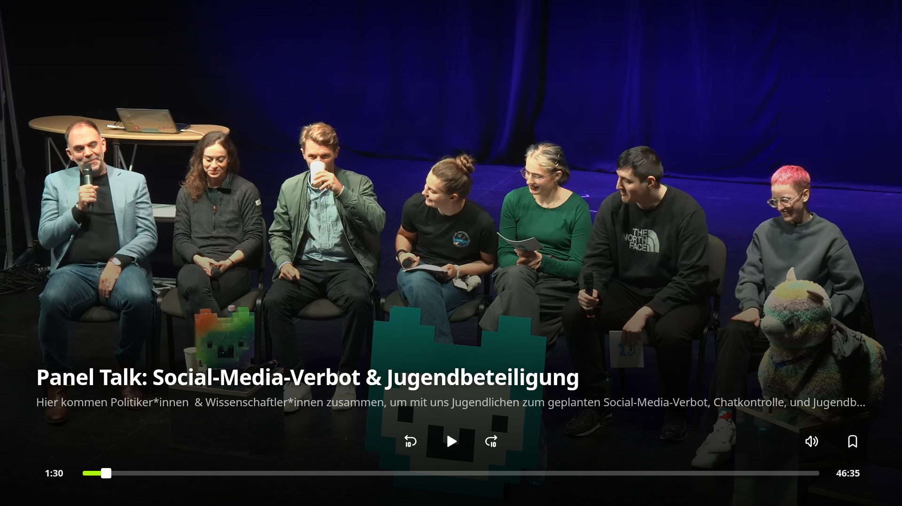

<h1></h1>

[](https://github.com/volkovmqx/cccbib/actions/workflows/main.yml)
[](https://github.com/volkovmqx/cccbib/blob/main/package.json)
[](LICENSE)
[](https://repo.webosbrew.org/apps/org.webosbrew.cccbib/)

[media.ccc.de](https://media.ccc.de) media library application for webOS.






## Background

This app uses the official media.ccc.de GraphQL endpoint. It uses TypeScript, React, Embla, and an HTML5 video player.

## Features

- Browse conferences with video previews and search for talks.
- Use the TV remote to navigate and control playback.
- Save talks to the Watchlist and resume the 20 most recent talks in Continue Watching.
- Select audio languages and subtitles when a talk provides them.
- Choose from 9 app languages.
- Change themes, accent colors, and fonts.
- Select Auto, Zoom, or Stretch for the video aspect ratio.
- Send commands through webOS launch parameters (see [Remote control](#remote-control)).

## Remote control

CCCBib takes its commands as webOS launch parameters so the TV needs no open port. It is off by default and you turn it on once in Settings (Playback and then Remote Control). A command is a JSON object. If the app is not running it starts and runs the command and if it is running it gets the command as a relaunch and nothing restarts.

<details>
<summary>Commands</summary>

| Command | Parameters |
| --- | --- |
| `play` (or only `link`) | `link` must be a `media.ccc.de/v/...` link (with https://, http:// or without a scheme), nothing else is accepted (no other host, no bare slug or GUID). Optional: `start` (seconds), `aspect` (auto, zoom, stretch), `subtitle` (language code or none), `language` (audio language code) |
| `pause`, `resume`, `toggle`, `stop` | none, `stop` closes the player |
| `seek` | `to` (seconds) or `by` (seconds, negative goes back) |
| `mute` | `value` true or false, without it the state toggles |
| `aspect` | `value`: auto, zoom or stretch |
| `subtitle` | `value`: language code or none |
| `language` | `value`: audio language code |
| `add` | `link`, `links` (list of links) or `items` (list of `{link, position}` or `{link, percent}`). Adds to the watchlist. With a `position` (seconds) or `percent` the talk is also put on the in progress list (Continue Watching) |
| `remove` | `link` or `links`. Removes from the watchlist only, a talk that has progress stays on the in progress list |
| `progress` | `link` with `position` (seconds) or `percent`, or `items` as above. The talk appears on the in progress list, the watchlist is not touched. Under 10 seconds clears the progress, the talk that is playing is moved with a seek |
| `progress-set` | `items` replaces the whole in progress list |
| `progress-clear` | `link` or `links`, removes the progress |

Every link in every command and list is checked the same way and talks that fail the check are skipped. `progress-set` changes nothing if a single link in the list is not valid or cannot be loaded. A command takes up to 50 links and the in progress list never holds more than 20 talks (the most recent ones).

Example, send a whole in progress list:

```json
{"cmd": "progress-set", "items": [
  {"link": "https://media.ccc.de/v/24c3-2303-en-inside_the_macosx_kernel", "position": 1200},
  {"link": "https://media.ccc.de/v/25c3-2874-en-the_ultimate_commodore_64_talk", "percent": 40}
]}
```

</details>

<details>
<summary>Sending commands and reading the state</summary>

From a shell on the TV:

```sh
luna-send -n 1 luna://com.webos.service.applicationmanager/launch \
  '{"id":"org.webosbrew.cccbib","params":{"cmd":"play","link":"https://media.ccc.de/v/24c3-2303-en-inside_the_macosx_kernel","aspect":"zoom"}}'
```

From a computer with the webOS CLI: `ares-launch org.webosbrew.cccbib -p '{"cmd":"pause"}'`.

From Home Assistant (LG webOS TV integration, not tested from Home Assistant yet):

```yaml
service: webostv.command
data:
  entity_id: media_player.lg_tv
  command: system.launcher/launch
  payload:
    id: org.webosbrew.cccbib
    params:
      cmd: play
      link: https://media.ccc.de/v/24c3-2303-en-inside_the_macosx_kernel
```

To read the state use the TV's web inspector (port 9998). `window.cccbib.report()` in the app page returns `state` (playing or paused or idle) and `now` (title and link and position) plus the `watchlist` and the in progress list with `link` and `position` for each. The page title also shows what is playing: `Playing: <talk title>` or `Paused: <talk title>` or `CCCBib` when no talk is open. With the inspector on `curl -s http://<tv-ip>:9998/json/list` lists it as `title`.

</details>

Zoom and Stretch call a TV service which webOS only allows for apps that were installed the normal way (`yarn deploy` or ares-install or the Homebrew Channel). Copying the files onto the TV by hand skips that registration.

## Subtitles

Old `.srt` (from 30c3) and new `.vtt` files both work. Languages that only exist as dead links or placeholder files are hidden and the subtitle button disappears when nothing usable is left. They load from the same CORS enabled hosts as the media.ccc.de website so no proxy is needed.

## Browser support

The target is Chrome 68 (webOS 5). The production build uses ES2019 syntax or older syntax. A startup error screen shows the error if the app fails to start. CI tests the production build in current Chromium, Chrome 68, and LG’s Simulator. See the [testing guide](CONTRIBUTING.md#tests-and-quality-checks).

## Roadmap

- &#9744; Add Speaker page.
- ~~&#9744; Jeopardy Theme song when waiting for too long.~~
- Playback speed is left out on purpose: webOS mutes the audio at any speed except 1x.

## Contributing

Contributions are welcome. You can report bugs, add translations, improve documentation, write tests, or submit code changes.

The application now uses strict TypeScript (`.ts` and `.tsx`) and Feature-Sliced Design (FSD). The [contribution guide](CONTRIBUTING.md) explains FSD, development setup, testing, the 95% coverage requirement, the coverage bot, and deployment.

## Contributors

[](https://github.com/volkovmqx/cccbib/graphs/contributors)

## Credit

The Logo ["Voctocat"](https://blinry.org/voctocat/) is kindly provided by [Blinry](https://github.com/blinry) under the CC BY-SA 4.0 License (as stated on the logo page). The animated loader (`src/shared/branding/voctocat.html`) is a modified version of it, where the raised arm is split off into its own shape so it can wave, and it is shared under the same license.

The TV navigation follows [Norigin Media's guide](https://noriginmedia.com/2019/06/24/smart-tv-navigation-with-react/) and [Utkarsh Gupta's guide](https://medium.com/@utkarsh.gupta.316/spatial-navigation-in-react-js-for-smart-tv-3aa6977a94b1). The remote button mapping uses the LG input keymapping overview by [Simon34545](https://github.com/Simon34545).

WebOS Project architecture from ["Informatic"](https://github.com/informatic/streamkatze)


## License

See [LICENSE](LICENSE).
