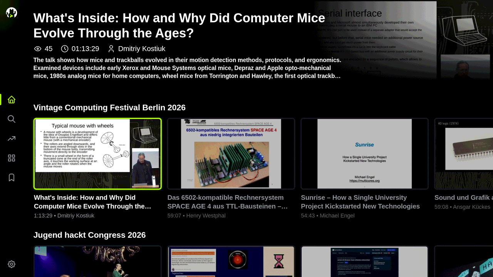
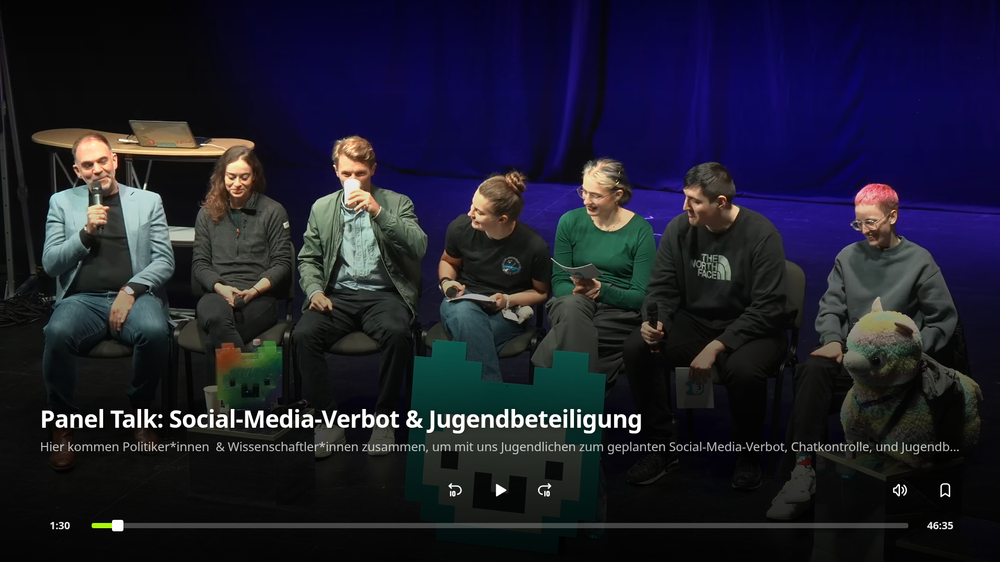

<h1></h1>

[media.ccc.de](https://media.ccc.de) media library application for webOS. Some call it the Netflix for Hackers. Others call it even nicer things so you should try it out and watch some smart talks.

## Background

This app uses the official media.ccc.de GraphQL endpoint. It uses TypeScript, React, Embla, and an HTML5 video player.

## Features

- Browse conferences with a preview of the selected talk (picture or short video) and search for talks.
- Save talks to the Watchlist and resume the 20 most recent ones in Continue Watching.
- Select audio languages and [subtitles](https://github.com/volkovmqx/cccbib/wiki/Subtitles) when a talk provides them. The app comes in 9 languages.
- A lot of customization! Themes yeah, Baby!
- Show technical details. Stats for Nerds!
- Control the app with webOS [launch commands](https://github.com/volkovmqx/cccbib/wiki/Remote-control) and publish what is playing to Home Assistant over [MQTT](https://github.com/volkovmqx/cccbib/wiki/Home-Assistant-over-MQTT).
- Use it in a browser on a phone or tablet. 

## Installation

You can install the app using one of the following methods:

- **[webOS Homebrew Channel](https://github.com/webosbrew/webos-homebrew-channel):** CCCBib is available in the official [webOS Brew repository](https://repo.webosbrew.org/apps/org.webosbrew.cccbib/).
- **[Device Manager](https://github.com/webosbrew/dev-manager-desktop):** Use the pre-built `.ipk` file from the [Releases](https://github.com/volkovmqx/cccbib/releases) page.
- **Command Line (webOS CLI):** Build it and install it yourself, see the [contribution guide](CONTRIBUTING.md#package-and-deploy-to-a-tv).

## Browser support

The target is Chrome 68 (webOS 5). The production build uses ES2019 syntax or older syntax. A startup error screen shows the error if the app fails to start. CI tests the production build in current Chromium, Chrome 68, and LG’s Simulator. See the [testing guide](CONTRIBUTING.md#tests-and-quality-checks).

## Roadmap

- &#9744; Add Speaker page.
- &#9744; Tag Filtering. 
- ~~&#9744; Jeopardy Theme song when waiting for too long.~~
- Playback speed on webOS goes through the TV's media service (`com.webos.media/setPlayRate`), because the web view mutes the sound at any other `playbackRate`.

## Contributing

Contributions are welcome. You can report bugs, add translations, improve documentation, write tests, or submit code changes.

The application now uses strict TypeScript (`.ts` and `.tsx`) and Feature-Sliced Design (FSD). The [contribution guide](CONTRIBUTING.md) explains FSD, development setup, testing, the coverage requirements, the coverage bot, and deployment.

## Contributors

## Credit

The Logo ["Voctocat"](https://blinry.org/voctocat/) is kindly provided by [Blinry](https://github.com/blinry) under the CC BY-SA 4.0 License (as stated on the logo page). The animated loader (`src/shared/branding/voctocat.html`) is a modified version of it, where the raised arm is split off into its own shape so it can wave, and it is shared under the same license.

The animation ["Fairy Dust"](https://media.metaebene.me/media/fairydust/index.html) is based on the Fairy Dust logo of the Chaos events, developed in 1999 by Tim Pritlove and Marten Suhr and released under the [CC BY 4.0 License](https://creativecommons.org/licenses/by/4.0/).

The Pixelated icon variant uses icons from [pixelarticons](https://github.com/halfmage/pixelarticons) ([website](https://pixelarticons.com/)) by Gerrit Halfmann under the [MIT License](https://github.com/halfmage/pixelarticons/blob/v2.4.2/LICENSE) (a copy is in `src/shared/branding/pixelarticons-LICENSE.txt`). The skip, wifi off and heart off icons are drawn on the same grid from the shapes of its play, wifi and heart icons.

The TV navigation follows [Norigin Media's guide](https://noriginmedia.com/2019/06/24/smart-tv-navigation-with-react/) and [Utkarsh Gupta's guide](https://medium.com/@utkarsh.gupta.316/spatial-navigation-in-react-js-for-smart-tv-3aa6977a94b1). The remote button mapping uses the LG input keymapping overview by [Simon34545](https://github.com/Simon34545).

WebOS Project architecture from ["Informatic"](https://github.com/informatic/streamkatze)

The themes and the look of the app are inspired by [Litefin](https://github.com/MoazSalem/litefin) by [MoazSalem](https://github.com/MoazSalem).

## License

See [LICENSE](LICENSE).
